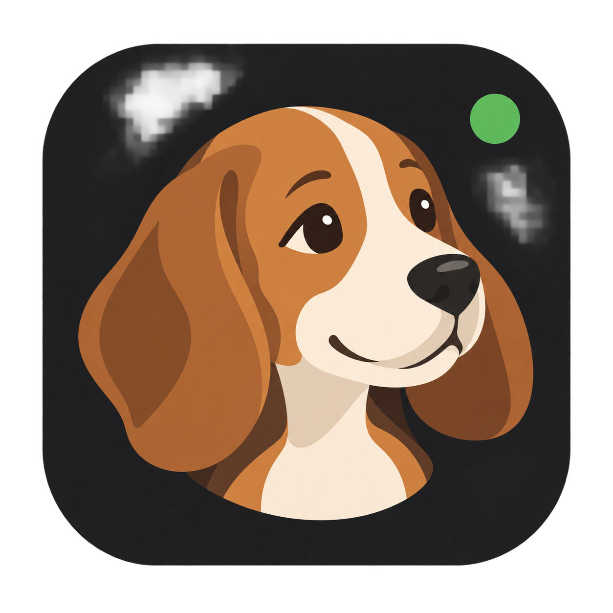

<div align="center">



# BeagleDock

**Multi-CLI for developers, on your own computer.**

Claude Code, Codex CLI and Antigravity in one place, with persistent conversations,<br>
a local model catalog, history and the usage recorded by the tools themselves.

[](https://github.com/rumofy/BeagleDock/releases/latest)
[](LICENSE)
[](#platforms)
[](#platforms)
[](#platforms)
[](#conversations-and-permissions)

[Releases](https://github.com/rumofy/BeagleDock/releases) · [Changelog](CHANGELOG.md) · [Contributing](CONTRIBUTING.md) · [Security](SECURITY.md) · [Third-party notices](NOTICE)

</div>

---

## Platforms

| Platform | Status |
| --- | --- |
| Linux x64 (Debian 13) | **Verified.** This is where BeagleDock is developed, tested (unit tests and `npm run test:desktop` with Electron) and packaged (`.deb`/AppImage). |
| Other Linux x64 distributions | **Should work, not verified.** The `.deb` is for Debian derivatives (such as Ubuntu) and the AppImage for the rest; reports are welcome. |
| Windows | **Experimental, open to the community.** The code handles Windows paths, `.cmd` launchers and shell, but the app has never been validated on this platform. |
| macOS | **Untested.** Homebrew and `zsh` are handled, without validation or code signing. |
| Linux ARM64 | **Untested.** No package is built for this architecture. |

Tried it on another platform or distribution? [Open an issue](https://github.com/rumofy/BeagleDock/issues/new) with the system, the version and the result, working or not. To bring BeagleDock to Windows, see [what needs to be validated](CONTRIBUTING.md#windows).

## Interface language

The interface is available in English (default), Spanish and Brazilian Portuguese; choose it in **Settings → Appearance**. Notifications, the tray menu and the prompts the app sends to the CLIs on your behalf (handoff, continuation in another CLI, plan approval, assisted memory maintenance) follow the chosen language. Voice dictation has its own language setting.

## Development

Use Node.js 22.12 or later, npm and the CLIs installed and authenticated on the system. The app discovers executables on the PATH and in each platform's usual directories; the terminal uses the system shell. The Windows and macOS instructions below are for people who want to test or contribute; those platforms aren't supported yet.

```sh
npm ci
npm run dev
```

`npm ci` builds the native dependencies for Electron and the current platform. Install Python and C++ tools: make/GCC on Linux, Xcode Command Line Tools on macOS or Visual Studio Build Tools with C++ on Windows. Building locally avoids loading SQLite binaries that require a newer glibc than the target Linux system. The data folder is `~/.beagledock` (database `beagledock.db`); it isn't part of the distribution. Use `BEAGLEDOCK_DATA_DIR` for an isolated development/test database. Don't point tests at your personal data.

The app starts without a profile, conversations or sample projects. Add projects through the interface. In development, the current directory may be offered as the initial workspace.

## Conversations and permissions

**CLI terminal is the recommended, default desktop interface.** In **Settings → Conversation interface**, you can also choose **BeagleDock chat (experimental)**. An explicitly saved choice is preserved. The terminal runs Claude Code, Codex CLI or Antigravity with its own interface, so models, permissions, approvals, plans and native commands stay under the CLI's control. BeagleDock organizes projects and conversations around those tools instead of reproducing every interaction.

The chat is experimental because translating three independently evolving CLI protocols into one interface requires ongoing compatibility work, especially for permissions and streaming. The native interface exposes each CLI's available features directly as it evolves. Chat remains an alternative with a unified presentation, and is currently the interface used for phone access; the CLI terminal is desktop-only.

Dictation, Handoff, quotas and conversation history remain available in terminal mode. Selecting a skill from the sidebar or reusing a history prompt pastes the request into the active terminal for review, without sending it. Files can be dragged in and clipboard content pasted, with attachment support handled by the CLI. New desktop CLI conversations first let you choose the workspace in the header, with the last workspace preselected. Click **Start CLI** to launch the terminal; the folder is locked from then on. To work in another project, create a new conversation and choose its workspace before starting. Older conversations with inconsistent project metadata recover the folder saved in their native session link, preserving their identifier and history. Keyboard shortcuts belong to the focused CLI; use the sidebar buttons for BeagleDock's skill picker and history while the terminal has focus.

Conversation dots, the header and the tray also track native CLI activity. New replies in other conversations are marked unread. Status comes from the CLI's terminal signals (Claude's title and Codex's state sequences) or screen activity and silence for Antigravity. When activity ends without a saved reply after retries, the app shows a generic waiting-for-interaction state; it cannot identify every native permission, plan or question from those signals. Answer those requests in the terminal itself.

SQLite stores the link between the app's conversation and the CLI's native ID. Terminal mode resumes that native conversation and syncs new messages from the CLI's saved history at the end of each reply and when the terminal closes or the CLI exits. In experimental chat mode, Claude and AGY reuse one process with stream-json; after a restart or a model/permission change, they resume the saved ID. Codex uses a persistent app-server, resuming the saved ID with `thread/resume` after a restart. Opening a conversation from the history imports its original ID and directory, including AGY. The chat automatically follows the questions sent and the reply received, including streaming updates. A started conversation stays tied to its original project; create another one to change project. A failure to resume never silently starts a new conversation.

The CLIs must offer the arguments used (check `--help`): Claude with stream-json and stdio permission control, Codex with `app-server`, AGY with stream-json, `--conversation` and hooks. The AGY adapter uses its `event: user` / `init` / `step_update` / `result` protocol; Claude uses `type` envelopes. The non-interactive quota query requires AGY 1.1.11 or later.

- **Plan/restricted:** planning mode in Claude/AGY and a read-only sandbox in Codex. Actions blocked by read-only mode aren't released automatically. Plan mode saves the conversation's previous permission; approving the plan or turning planning off restores that permission, even after an app restart.
- **Accept edits:** acceptEdits/accept-edits in the corresponding CLIs and workspace-write in Codex.
- **Full access:** requires an explicit choice in the interface; allows the CLI's no-approval mode.

These policies follow each CLI's guarantees; planning mode isn't the same as operating system isolation. Messages sent to the same conversation go into an automatic queue; other conversations stay independent. Attachments are never sent silently: what a CLI doesn't support shows up as a notice in the interface.

## Models and usage

The app imports IDs from the Claude and Codex caches and queries `agy models`. The model and level pickers are separate and come from the CLIs' metadata: Claude's `thinking.effort_options`/`runtime.effort_levels`, Codex's `supported_reasoning_levels` and the variants labeled by `agy models`. There's no fixed list of levels. Catalog changes replace the available options; without metadata, the level stays at the CLI default. The backend validates the current selection and converts model + level into AGY's correct native ID. It respects `CLAUDE_CONFIG_DIR` and `CODEX_HOME`; without a catalog, it lets you use the CLI's default model. It doesn't ship made-up lists or download model weights: the providers used are those of the authenticated CLIs. Update/authenticate the CLI to fill its local catalog.

Tools and usage refresh every 15 seconds and after a run; AGY's remote catalog is queried at most once a minute. History and skills refresh every 30 seconds. Logs are processed outside the interface process.

Claude queries its usage API when local OAuth credentials are available. Codex shows the last recorded rate limit with its date and a stale-reading indicator. AGY queries `agy -p /usage --output-format json` every 45 seconds, without creating a conversation, and shows quotas split by model group. The AGY summary always uses the Gemini Models group, regardless of the chat's model; the other groups stay visible in the details. Missing, disabled or expired buckets show as **N/A**. Prompts/tokens come from local logs; cached tokens are a subset of the input and aren't added again. Token totals cover the last seven days of available records, with snapshot deduplication. A failed query marks old data as stale. MCP configuration is shown as configured, without assuming an active connection.

## Credentials and browser

Saved keys are encrypted with Electron's `safeStorage`. The Linux `basic_text` backend is refused. When no keyring is available, new keys aren't saved. Old plain-text credentials are migrated when the desktop app opens with the keyring available; SQLite uses secure_delete and a compaction after the migration. This doesn't erase earlier database backups. The renderer only gets indicators that a key is saved. The CLIs keep using their own authentication; saving a key doesn't configure the CLIs or enable an additional API provider.

The HTTP bridge is off in the desktop flow, avoiding two competing backends. To develop only in the browser, set the variable before running `npm run dev:vite`:

```sh
# Linux/macOS
BEAGLEDOCK_BROWSER_BRIDGE=1 npm run dev:vite
```

```powershell
# Windows PowerShell
$env:BEAGLEDOCK_BROWSER_BRIDGE = '1'
npm run dev:vite
```

Open **http://127.0.0.1:5173**. The bridge requires a local origin, a temporary token and a bounded JSON body. Don't expose the port through tunnels or proxies. The browser doesn't have Electron's keyring to save keys. The local contract is in [docs/openapi.json](docs/openapi.json).

## Phone access

BeagleDock can be used from a phone on the same Wi-Fi or private network: **Settings → Phone access**. It's off by default. Once on, the app opens an HTTPS server (port 47821) that serves the desktop chat laid out for a phone, for Claude Code, Codex CLI and AGY: the conversation list with quotas and notifications, the CLI history, and the full chat (model, level and permission, attachments and photos, dictation, commands and skills, the queue, plan review, context and the timeline, rename and archive) plus the CLIs' approval requests. The phone calls the same backend as the desktop, and each screen updates when the other changes a conversation, including replies still arriving. The phone has no access to the terminal, settings, project registration or memory maintenance, and only works in registered projects or in a conversation's own folder.

1. Turn it on and click **Pair a phone**: a QR code and a one-time code appear (valid for 5 minutes, 5 attempts, one device).
2. Scan it with the phone's camera. The first time, the browser warns that the connection isn't private: continue to the site, download the certificate and trust it (on iPhone: Settings → General → VPN & Device Management, then Settings → General → About → Certificate Trust Settings). Check that its fingerprint matches the one shown on the desktop.
3. Enter the code and tap **Pair**. In Safari, **Share → Add to Home Screen** opens it like an app; the Home Screen app pairs on its own with a new code.

Security: the server only accepts connections from private addresses (LAN, link-local and private overlay networks such as Tailscale) and only `.local`, localhost or private IP host names. Each paired device gets its own token, stored only as a hash and revocable in Settings; revoking closes its open connection. The certificate is signed by a local authority created on this computer, name-constrained to `.local` names so it can't vouch for internet domains; its keys are protected by the system keyring when available. Never forward the port through your router or a public tunnel. The phone interface comes from the built frontend (`dist/mobile.html`): in development, run `npm run build:vite` first.

## ai-memory explorer

The memory tab lists the ai-memory server's projects, groups pages by folder, shows the base's health (orphaned, duplicated, stale) and renders each page in Markdown, with navigable `[[links]]`. **Assisted Maintenance** opens a conversation in the chosen CLI (model and level as in the chat) with a script to consolidate fragmented pages; by default it presents the plan and waits for your approval before any deletion. Pages in `decisions/` are never deleted by the script, and deleting a project requires typing `workspace/project`. The server and the token are read from `AI_MEMORY_SERVER_URL`/`AI_MEMORY_AUTH_TOKEN` or from the files in `~/.config/ai-memory` and `~/.local/share/ai-memory`; the token never reaches the interface.

## Checks and packages

```sh
npm test
npm run typecheck
npm run build:vite
npm run build:electron -- --dir
# Linux with a graphical session: Electron test with offline CLIs
npm run test:desktop
```

The tests use temporary databases, sample logs, simulated CLI processes and a local HTTP server without access to real accounts. They cover resuming, permissions, concurrency, errors, metrics, catalogs, encryption, bridge protection and the parity of the interface languages.

## Local installation (Linux)

The package is built and installed on the machine itself; CI only runs types, tests and the frontend build, without publishing installers.

```sh
npm ci
npm run build          # typecheck + frontend + packages in release/
npm run install:local  # installs the built .deb (asks for sudo)
```

`release/` gets `BeagleDock-<version>-linux-amd64.deb` and `BeagleDock-<version>-linux-x86_64.AppImage`.

**Debian/Ubuntu (recommended):**

Installs into `/opt/BeagleDock`, creates the `beagledock` command and the application menu shortcut. To update, build the new package (`npm run build`) and run `npm run install:local` again; to remove, `sudo apt remove beagledock`. Conversations and credentials live in `~/.beagledock` and aren't deleted on removal.

**AppImage (no installation):**

```sh
chmod +x release/BeagleDock-*-linux-x86_64.AppImage
./release/BeagleDock-*-linux-x86_64.AppImage
```

If the AppImage complains about FUSE, install `libfuse2` (on Debian 13: `sudo apt install libfuse2t64`).

### Versions and changelog

The app version lives only in `package.json`. User-visible changes are recorded in `CHANGELOG.md` (the `Unreleased` section) and, to release, use `npm version patch|minor|major`: the script moves `Unreleased` to the new version and syncs the links and `docs/openapi.json`, without a commit or tag. The full rules are in `AGENTS.md`.

To only test packaging without building installers, use `npm run build:electron -- --dir` and run `release/linux-unpacked/beagledock`. There's no automatic app update or code signing; the update buttons in the interface update only the CLIs.

Codex protocol reference: [official non-interactive mode documentation](https://learn.chatgpt.com/docs/non-interactive-mode).

AGY references: [usage report](https://antigravity.google/docs/cli/commands/usage/) and [headless protocol](https://antigravity.google/docs/cli/headless).

The provider icons are files from the official sites, bundled for offline use; sources and hashes are in [public/providers/SOURCES.md](public/providers/SOURCES.md).

The settings show each CLI's native global permissions. Saving changes only the chosen fields, preserving rules and other options. In the chat, “CLI global” inherits these defaults on the next runs; a specific selection applies only to the conversation. The chat presents eligible per-action approval requests. In AGY, plan/restricted apply explicit rules to block commands, MCP, web access and writes. Accept edits may ask for command approval through the panel. Global deny rules are preserved.

The bell keeps notices of new models detected in the synced catalogs, new installations of the three supported CLIs and published stable versions. The version check runs every hour and can be triggered manually; failures stay visible. Sources: the official Claude Code/Codex releases on GitHub and the official AGY updater manifest. These notices don't supply any model list.

“Update CLI” runs `claude update` or `agy update`; for Codex it identifies npm or Homebrew installations. With npm it keeps the detected installation's prefix. Unrecognized installations require their original package manager. Updates wait for runs to finish, close idle processes and preserve the conversations' identifiers for resuming. They never run automatic privilege elevation.

References: [Claude permissions](https://code.claude.com/docs/en/permissions), [Codex configuration](https://learn.chatgpt.com/docs/config-file/config-reference), [AGY schema](https://antigravity.google/schemas/v1/settings.json) and [AGY updates](https://antigravity.google/docs/cli/commands/changelog).

During a reply, the chat keeps accepting messages. They go into a per-conversation queue and follow automatically, in order, after the current turn, keeping the native identifier. The run queue lives in the current process; messages already saved stay in the history after a restart. Deleting a conversation also cancels its pending sends.

The shell uses xterm, keeps ANSI colors and shows commands, diagnostics and incremental results received from the CLI. When the provider only publishes a tool's output at the end, the shell gets that output at that moment; the app can't anticipate bytes the CLI doesn't send. Greeting titles are replaced by the first request with an identifiable subject, including in the saved history.

The brand is **BeagleDock**, with a [beagle mascot](public/brand/beagledock-logo.png). On the first run after the rename, the app automatically migrates the data and settings of the previous version (data folder, database, Electron profile and AGY approval hook) without losing conversations. API keys saved in the app, encrypted by the system keyring under the old name, may need to be saved again; the CLIs keep their own authentication. `BEAGLEDOCK_DATA_DIR` sets an alternative directory. Details and the logo prompt: [visual identity](docs/brand/LOGO.md).

The chat presents per-action permission requests for all three providers. Claude uses the stdio control protocol; Codex uses the app-server's requests; AGY uses a `PreToolUse` hook with an authenticated socket, active only when launched by BeagleDock. The hook preserves the other settings and keeps a previous copy of `hooks.json`; outside BeagleDock it defers to the original policy. Allowing once doesn't create a global permission or remove explicit deny rules.

Streaming reads task artifacts from the native session for Claude/AGY and uses the app-server's deltas for Codex. The chat shows activity and elapsed time during tools. Scenarios, verified versions and optional diagnosis with real CLIs: [CLI contracts](test/PROTOCOLS.md).

**Stop** interrupts the run and the CLI's child commands, cancels the sends already queued and that conversation's pending approvals. The native identifier, the messages and the partial reply text are kept. New messages can resume the same conversation; the other chats stay independent. With a run active, `para`, `parar`, `pare`, `cancela`, `cancelar`, `stop` and `/stop` also trigger the interruption immediately, without going into the queue.
